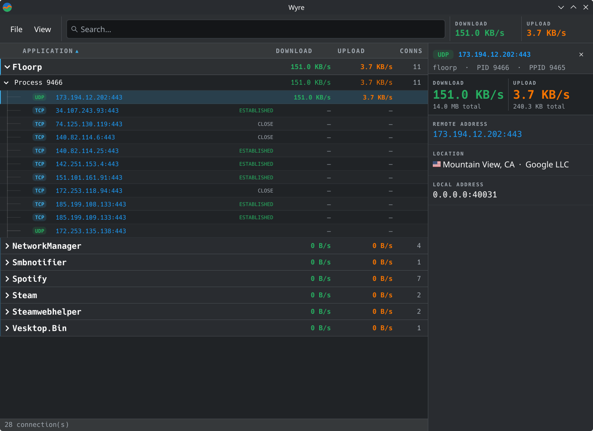

# Wyre
 
Wyre shows all network connections made by programs on your system.

## Features
 
- Tracks TCP, UDP and ICMP connections, grouped by program and process
- Live download and upload rates and totals for each connection, process and program
- Search by program or address and filter by protocol
- Geolocation of all internet IP addresses, from free databases Wyre downloads or MMDB files you import
- Tracks connections with eBPF hooks, through a daemon that uses very little CPU

## Easy install
[&logo=flatpak&logoColor=white&style=for-the-badge)](https://github.com/skepy1337/wyre/releases/latest/download/wyre-x86_64.flatpak)
[](https://github.com/skepy1337/wyre/releases/latest/download/wyre-aarch64.flatpak)

If on Ubuntu, run `sudo apt install flatpak`

Then, run this command to install:
```sh
flatpak install --system wyre-*.flatpak
```
### How it works

The connections are tracked by `wyre-daemon`, which loads an eBPF program into the kernel.
The client gets them from the daemon's socket, `/run/wyre/wyre.sock`.

A user can only see their own programs' and system connections. Other users' are shown only to root.

To let all users see every connection, disable isolation by creating
`/etc/wyre/no-user-isolation` as root.

```sh
sudo mkdir -p /etc/wyre
sudo touch /etc/wyre/no-user-isolation
```



### Building from source

#### Dependencies

##### Arch
```sh
sudo pacman -S --needed base-devel rustup bpf-linker qt6-base qt6-declarative kirigami
rustup default stable
rustup component add rust-src
```
##### Fedora
```sh
sudo dnf install gcc-c++ qt6-qtbase-devel qt6-qtdeclarative-devel kf6-kirigami rustup
rustup-init -y
. "$HOME/.cargo/env"
rustup component add rust-src
cargo install cargo-binstall --locked
cargo binstall bpf-linker
```
##### Ubuntu 26+ / Mint 23+
```sh
sudo apt install g++ qt6-base-dev qt6-declarative-dev \
    qml6-module-qtquick qml6-module-qtquick-controls qml6-module-qtquick-layouts \
    qml6-module-qtquick-dialogs qml6-module-qt-labs-qmlmodels qml6-module-org-kde-kirigami
sudo apt install rustup
rustup default stable
rustup component add rust-src
cargo install cargo-binstall --locked
cargo binstall bpf-linker
```

### Installing
```sh
cargo build --release --locked

sudo install -Dm755 -t /usr/local/bin target/release/wyre target/release/wyre-daemon
sudo install -Dm644 -t /usr/local/share/applications res/dev.skepy.wyre.desktop
sudo install -Dm644 -t /usr/local/share/metainfo res/dev.skepy.wyre.metainfo.xml
sudo install -Dm644 -t /usr/local/share/icons/hicolor/scalable/apps res/dev.skepy.wyre.svg

sudo install -Dm644 -t /etc/systemd/system wyre-daemon.service
sudo systemctl daemon-reload
sudo systemctl enable --now wyre-daemon
```

### Building Flatpak

Install flatpak-builder beforehand
aiohttp and tomlkit are needed python modules if you want to run `update-sources.sh`
```sh
flatpak install flathub org.kde.Sdk//6.11 org.freedesktop.Sdk.Extension.rust-stable//25.08
flatpak-builder --install-deps-from=flathub --force-clean --repo=repo build-dir flatpak/dev.skepy.wyre.yaml
flatpak build-bundle repo wyre.flatpak dev.skepy.wyre \
    --runtime-repo=https://dl.flathub.org/repo/flathub.flatpakrepo
flatpak install --system wyre.flatpak
```

## Uninstalling

### Native
```sh
sudo systemctl disable --now wyre-daemon
sudo rm /etc/systemd/system/wyre-daemon.service
sudo systemctl daemon-reload

sudo rm -f /usr/local/bin/wyre /usr/local/bin/wyre-daemon \
    /usr/local/share/applications/dev.skepy.wyre.desktop /usr/local/share/metainfo/dev.skepy.wyre.metainfo.xml \
    /usr/local/share/icons/hicolor/scalable/apps/dev.skepy.wyre.svg
sudo rm -rf /etc/wyre

rm -rf ~/.config/wyre ~/.cache/wyre ~/.local/share/wyre
```

### Flatpak
```sh
sudo systemctl disable --now wyre-daemon
sudo rm /etc/systemd/system/wyre-daemon.service /etc/tmpfiles.d/wyre.conf
sudo systemctl daemon-reload
sudo rm -rf /run/wyre /etc/wyre
flatpak uninstall dev.skepy.wyre --delete-data
```

## Attribution

- Location databases: [ip-location-db](https://github.com/sapics/ip-location-db), and [DB-IP](https://db-ip.com), CC BY 4.0
- Running the daemon from the Flatpak: [flatbox](https://github.com/ilya-zlobintsev/flatbox) by Ilya Zlobintsev, MIT license
- Flag images: [flag-icons](https://github.com/lipis/flag-icons) by Panayiotis Lipiridis, MIT license